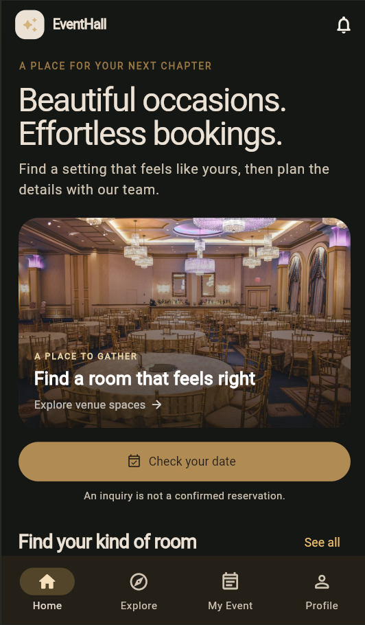

# EventHall — Venue Discovery & Event Inquiry App (Flutter)

A cross-platform **Flutter** front-end application for browsing event spaces, exploring venue details, and submitting date inquiries. Designed with a warm editorial aesthetic (champagne gold and ivory/charcoal Material 3 palette) and an adaptive responsive layout that scales seamlessly between mobile phones and laptop/desktop screens.

> **Prototype Notice:** This repository contains the front-end UI prototype. Connect the screens and inquiry workflow to your live booking and authentication APIs before treating availability, quotes, or reservations as live.

---

## Preview


## Key Features

- **Adaptive Multi-Device Layout:**
  - **Mobile (`< 760px`):** Bottom `NavigationBar` with single-column touch-friendly cards and horizontal carousels.
  - **Laptop & Desktop (`>= 760px`):** Collapsible/extended left `NavigationRail`, centered content containers (`maxWidth: 1140px`), 2-column hero split, multi-column room grids, and mouse/trackpad drag scrolling support.
- **Venue Exploration & Filtering:** Browse featured spaces (*The Grand Hall*, *The Gallery Room*, *The Courtyard*) with category filters (`All spaces`, `Weddings`, `Celebrations`, `Corporate`), capacity tags, and amenity chips.
- **Interactive Date Inquiry Form:** Validated booking request form supporting event type selection, room preference, guest count, date picker, start/end time validation, and communication consent toggles.
- **Event Status Tracker (`My Event`):** Clear 3-stage inquiry-to-confirmation lifecycle view (*Inquiry received* → *Quote and review* → *Reservation confirmed*) with an entry point for customer sign-in/secure booking access.
- **Light & Dark Theme Support:** Instant theme switching between warm daylight ivory (`#F7F5EF`) and evening charcoal (`#151714`) with champagne gold (`#B08B53` / `#D3B47C`) accents.

---

## Tech Stack

- **Framework:** Flutter (Material 3)
- **Language:** Dart
- **Architecture:** Single-entry stateful shell (`EventHallShell`) with `IndexedStack` navigation and responsive breakpoint builders (`LayoutBuilder` / `MediaQuery`).

---

## Project Structure

```text
eventhall/
├── assets/
│   └── preview.png        # App UI screenshot
├── lib/
│   └── main.dart          # App theme, responsive shell, screens, and UI components
├── pubspec.yaml           # Flutter dependencies and metadata
└── README.md              # Project documentation
